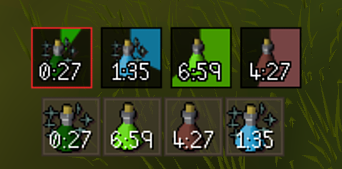
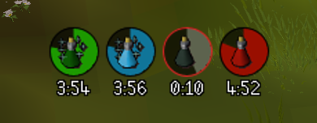
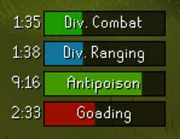

# Ultimate Timers & Counters

Configurable countdown timer overlays that displays timer progress visually.

## Features

- Default settings match infobox shape and layout with a "clock" background indicator.
- Enable or disable individual timers.
  - Timers grouped into 5 categories with custom settings for each (list below).
- Timers can flash when low to alert you.
  - Flash time, color, and style are configurable per category (ex. buffs can flash red when low, debuffs (like being teleblocked) can flash green when low).
- Timers can linger after they expire as a further reminder. No need for a separate plugin to remind you to cast another thrall or repot.
  - Toggle and duration of lingering effect is configurable per category.
- Timers can be regrouped and rearranged just like infoboxes by using *shift + right-click*.
  - "Detach" removes that timer to its own group and lets you build a new group
  - "Move up" and "Move down" change timers relative positions to each other within a group. The relative positions will be remembered so timers always appear in the order you expect.
  - "Flip" toggles the timer stacking between horizontal and vertical
- Customizeable text and icon settings
  - Change position, size, font, color, etc.
  - Toggleable tooltip text
- Fully configurable size, shape, color, text settings and more 
  - Change shape and size of the timer
  - Color is configurable per timer. A global override is available too.
  - Change fill style to go from a clock to a progress bar or anything in between
- Debug settings that let you arrange all the timers and test your settings without needing to activate their effects in-game

## List of Supported Timers

Nearly all timers require the **"Timers & Buffs"** default plugin to be enabled.

- Buffs
  - Antifire/super antifire
  - Antivenom/poison
  - Charge spell
  - Divine potions (Bastion, Battlemage, Magiv, Ranging, Super Att, Super Combat, Super Def, Super Str)
  - Goading potion
  - Imbued heart
  - Magic Imbue
  - Menephite remedy
  - Moonlight potion
  - Necromancy spells (Shadow Veil, Ward of Arceuss, Death Charge, Mark of Darkness)
  - Overload potions
  - Prayer enhance potion
  - Prayer regeneration potion
  - Smouldering heart & gland
  - Stamina potion
  - Thralls
  - ToA supplies
  - Vengeance
- Debuffs
  - Freeze (Bind/Snare/Entangle, Ice spells)
  - Pickpocket stun
  - Teleblock
- Cooldowns
  - Dragonfire shield special attack
  - Heal group
  - Spellbook swap
  - Staff of the dead special attack
  - Surge potion cooldown
  - Home and minigame telepoprt cooldowns
- Other Timers
  - AFK logout
  - Boss mechanics (Abyssal Sire stun, Scurrius food pile, God Wars altar)
  - Boss Respawn (requires the **"Boss Timers"** default plugin to be enabled)
  - Cannon and broken cannon timers
  - Delayed heal (from hunter meats)
  - Farmer's affinity
- Counters
  - Slayer Task (requires the **"Slayer"** default plugin to be enabled)

  
## Planned Features

- Padding offset option for Time text, Description text, and icons
- Fixed maximum so the 100% value is relative to a fixed value instead of the timers starting value
  - For example, set the maximum to 2 minutes so the visual indicator shows 100% above 2:00, 75% at 1:30, and so on across all timers
- Multiple custom shape presets, allowing you to use different shapes for different timers instead of forcing all timers to the same shape
- Toggle to replace other plugins infoboxes so they don't need to be disabled manually
